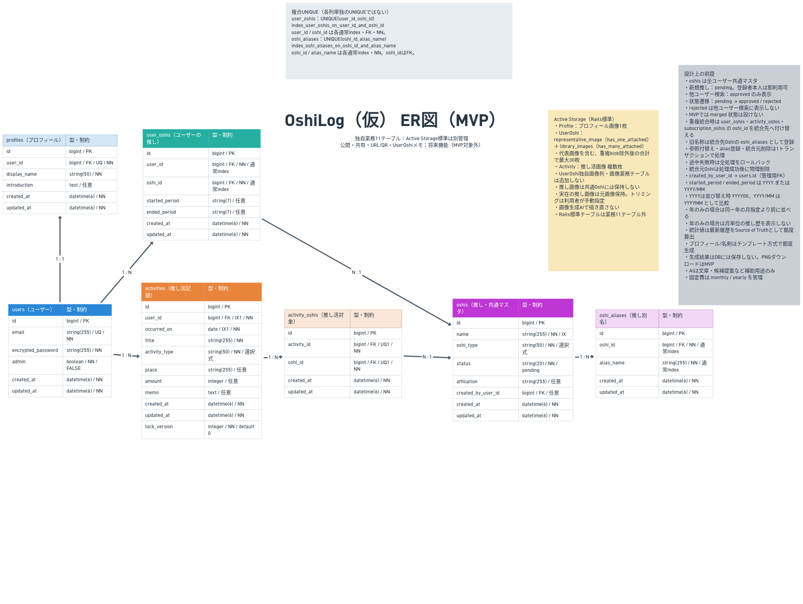
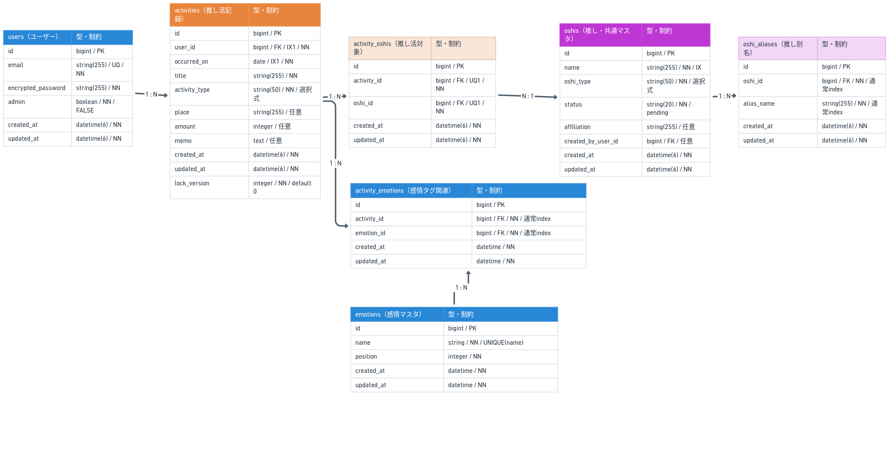
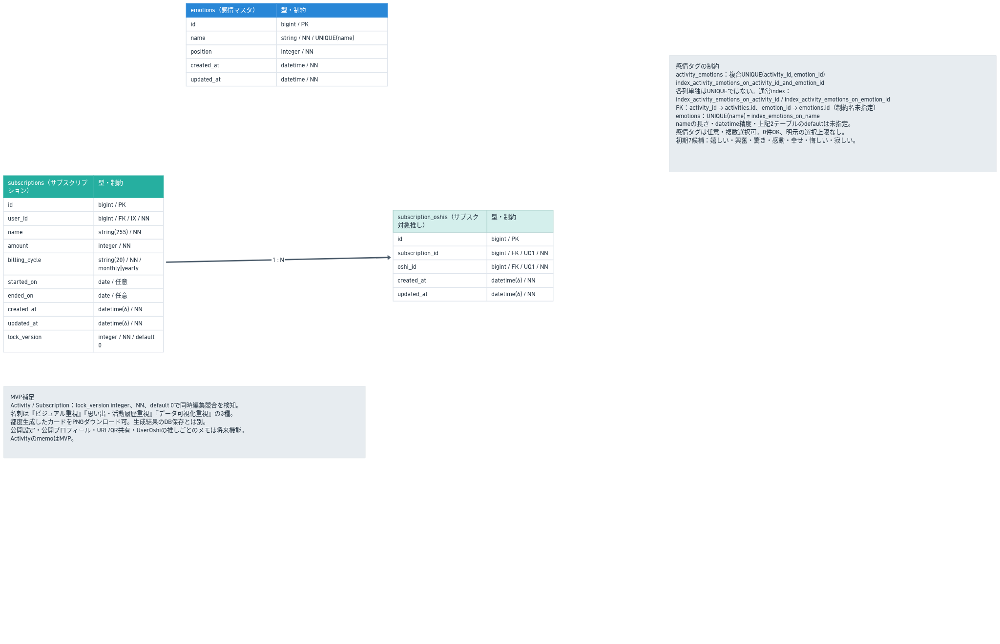
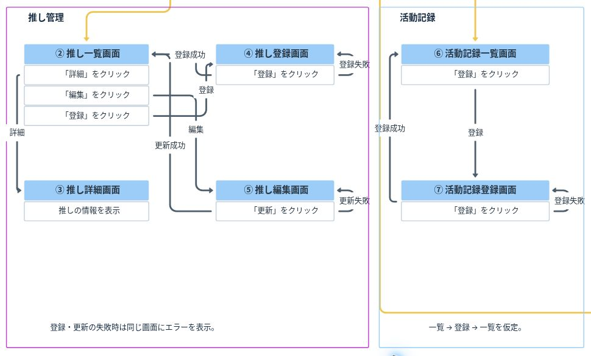
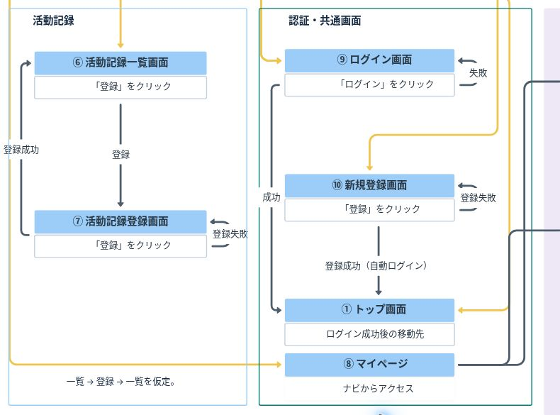
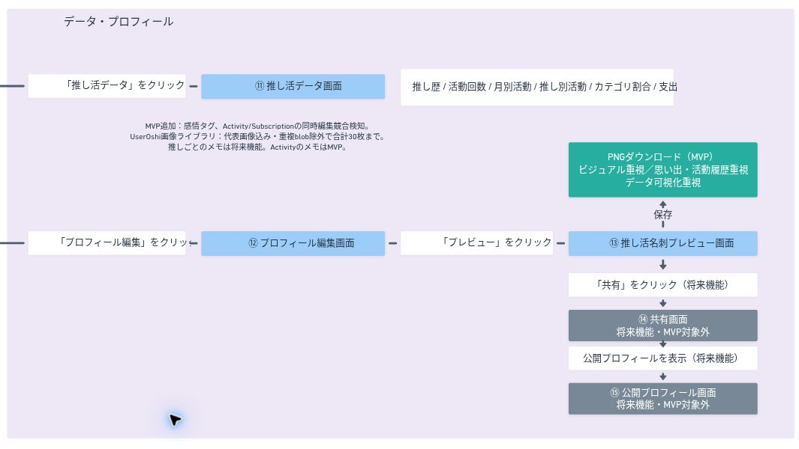

# OshiLog（仮）

## アプリケーション概要

OshiLog（仮）は、推し活を「記録する・振り返る・可視化する」ためのWebアプリケーションです。

推し活の履歴を蓄積し、活動回数・支出・推し歴・活動傾向などを可視化することで、自分がどのような推し活をしてきたかを振り返れるサービスを目指します。

MVPの中心は「記録・振り返り・可視化」とし、プロフィール・名刺生成は付加価値として位置づけます。

外部公開、URL・QRコードによる共有、ユーザー同士の交流機能については将来機能として検討します。

本番環境：[OshiLogを利用する](https://13.115.187.119/)

## 開発環境

- Ruby 4.0.6（`.ruby-version`）
- Ruby on Rails 8.1系（正確なバージョンは`Gemfile.lock`を参照）
- PostgreSQL 18系
- libvips

システムテストを実行する場合は、Chrome / ChromeDriverと日本語フォントも必要です。

## 実行手順

PostgreSQLを起動し、このリポジトリを取得します。

```bash
git clone https://github.com/c8bji5ma-lgtm/oshi-log-capstone-project.git
cd oshi-log-capstone-project
```

ロックファイルで確定したGemをインストールします。

```bash
BUNDLE_FROZEN=true bundle install
```

開発用データベースを準備します。

```bash
bin/rails db:prepare
```

初期データが必要な場合だけseedを実行します。development環境ではローカル確認用のデモデータも作成されるため、既存データがある環境では内容を確認してから実行してください。

```bash
bin/rails db:seed
```

Railsサーバーを起動し、`http://localhost:3000`へアクセスします。

```bash
bin/rails server
```

テストはdevelopment DBと分離された`my_app_test`と`tmp/storage`を使用します。

```bash
BUNDLE_FROZEN=true RAILS_ENV=test bundle exec rspec
```

静的チェックは次のコマンドで実行できます。

```bash
BUNDLE_FROZEN=true bin/rubocop
BUNDLE_FROZEN=true bin/brakeman --quiet --no-pager --exit-on-warn --exit-on-error
BUNDLE_FROZEN=true bin/bundler-audit
BUNDLE_FROZEN=true bin/importmap audit
```

実装状況とIssue #31の最終QA対応は[Issue #31 QA対応表](docs/issue-31-qa.md)を参照してください。

## 要件定義資料

初回の要件定義後、実装前の再検討および画面設計の見直しを行い、画面構成・画面遷移・グローバルナビゲーション等を更新しています。

実装時は、本READMEおよび以下に掲載している最新の要件定義資料・画面遷移図・ワイヤーフレームを基準とします。

### チェックシート

[チェックシートを確認する](https://docs.google.com/spreadsheets/d/1hWaamzG78rVdf1tu79aZMsmti1YSxQMKiD_1AjhuCVg/edit#gid=1321893864)

### カタログ設計

[カタログ設計を確認する](https://docs.google.com/spreadsheets/d/1hWaamzG78rVdf1tu79aZMsmti1YSxQMKiD_1AjhuCVg/edit#gid=697294974)

### テーブル定義書

[テーブル定義書を確認する](https://docs.google.com/spreadsheets/d/1hWaamzG78rVdf1tu79aZMsmti1YSxQMKiD_1AjhuCVg/edit#gid=1645989784)

### ワイヤーフレーム

[Whimsicalでワイヤーフレームを確認する](https://whimsical.com/yuki-atarashi/oshilog-kpi-4JZqsPQdZ6TfN7LoLxQJbw)

## ER図

文字が確認しやすいよう、ER図を3枚に分けて掲載しています。







掲載画像は2026年10月22日の保存版です。現行schemaとの照合状況は[Issue #31 QA対応表](docs/issue-31-qa.md)を、図全体と補足は以下のWhimsical原本を参照してください。

[WhimsicalでER図を確認する](https://whimsical.com/yuki-atarashi/oshilog-er-mvp-PDbRKWDyLu1fJfbJxNVMP6)

## 画面遷移図・ワイヤーフレーム

2026年10月22日に保存した画面設計を、左・中央・右の3枚に分けて掲載しています。

### 左（推し管理・活動記録）



### 中央（活動記録・認証・共通画面）



### 右（データ・プロフィール・PNG保存・将来機能）



グローバルナビゲーション、注記、画像の境界をまたぐ接続を含む全体は、以下のWhimsical原本を参照してください。

[Whimsicalで画面遷移図を確認する](https://whimsical.com/yuki-atarashi/oshilog-BXfu4fkBrWUUJmT5NJb2Qi)
